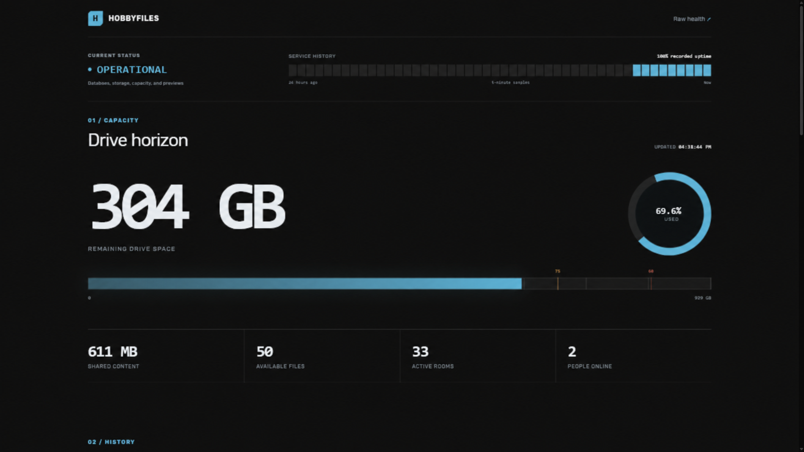

<!-- markdownlint-disable MD033 -->

<div align="center">

  <h1>Hobbyfiles</h1>

  <p>A place for hobby groups to share files, find useful things, and talk about them.</p>

  <p>
    <a href="#readme"></a>
    <a href="./package.json"></a>
    <a href="https://github.com/apoapostolov/Hobbyfiles/releases/latest"></a>
    <a href="https://github.com/apoapostolov/Hobbyfiles/releases/latest"></a>
  </p>

</div>

<div align="center">
  <a href="https://github.com/apoapostolov/Hobbyfiles">
    </a>
</div>

Hobbyfiles gives hobby groups a room to share files and talk about them. Use it
for RPG books and maps, board-game files, 3D prints, comics, fiction, and other
collections worth browsing together. Each room brings chat, temporary uploads,
requests, file readers, moderation, and optional automation together. You run
the server yourself; there is no public Hobbyfiles service.

## New in Hobbyfiles 1.5.0

Read books and comics, inspect 3D printing models, and watch movie or TV torrents
without leaving your room. ZIP previews can open documents, comics, images,
videos and models together with their linked textures. Continue Reading keeps
up to ten books handy, while Continue Watching remembers video timestamps.

Movie and TV torrents now show searchable contents, peer counts, matched titles,
subtitles, and watch progress. Watch opens the largest movie video or the first
unfinished episode in a season pack, skipping episodes watched to 90%. Streams
start automatically when ready. The interface includes 34 themes and compact
phone and tablet controls.

For room owners, 27 opt-in bots collect approved feeds and cloud files, help
manage the community, and handle maintenance. Plugin API v2, 57 scoped MCP tools
and Linux amd64/arm64 GHCR images support automation and self-hosting. See
[What You Can Do](#what-you-can-do) for an overview, or browse the
[changelog](CHANGELOG.md) for the full list. If you run a server, read the
[upgrade notes](CHANGELOG.md#operator-notes) and set up provider connections
before turning on collection bots.

## What You Can Do

- **Share and chat in one room.** Post messages, upload files, share images and GIFs, and let moderators manage the room and its file-retention rules.
- **Find files by browsing.** Switch between a compact list and a gallery, then use covers, search, filters, and tags to narrow the collection.
- **Read in the room.** Open PDFs, ePubs, MOBI/AZW books, and CBZ/CBR/CB7 comics with reading progress and keyboard controls.
- **Look inside archives.** Browse ZIP, RAR, 7Z, TAR, multipart archives, and comics. Preview supported documents, comics, images, videos, and 3D models without unpacking everything first.
- **Request what’s missing.** Post a request, add a link or image for context, and let someone’s upload fill it.
- **Bring in files from other rooms.** Link rooms on the same server or on a trusted Hobbyfiles server. Filter what appears, while the source room keeps control of its files.
- **Run a private community.** Use expiring guest invites, rotating room passwords, and moderator roles to manage access.
- **Automate routine work.** Connect bots and other tools through the REST API, webhooks, and 57 scoped MCP tools.
- **Use more than one drive.** Add storage volumes, keep an eye on free space, and leave existing files where they are.
- **Pick a look that suits the room.** Choose from 34 themes, including 26 dark themes, in Appearance.
- **Browse torrents.** Add magnet links or `.torrent` files, search their contents, check reported peer counts, and stream supported videos.
- **Follow a movie or episode.** Match torrent files to catalogue entries, browse artwork and cast, add subtitles, and resume long videos where you left off.
- **Inspect 3D models in your browser.** Open STL, 3MF, OBJ, glTF/GLB, PLY, FBX, and USD files in the Babylon.js viewer, including models inside ZIP archives with their linked geometry, materials, buffers, and textures.


## Built-in Readers & Viewers

- **PDF:** lazy page rendering, range requests, zoom, progress, and download.
- **ePub:** A5-style pages, chapter navigation, typography controls, and soft page curls.
- **MOBI / AZW / AZW3:** browser-side parsing with the same paginated reading view.
- **Comics:** sequential CBZ, CBR, and CB7 pages with keyboard navigation.
- **3D objects:** inspect STL, 3MF, OBJ, glTF/GLB, PLY, FBX, and USD models in the Babylon.js viewer, including models opened from supported archives with linked assets.

PDF, ePub, and MOBI reading runs in the browser. Native tools are used only for
server-generated previews and formats such as RAR/7Z extraction.


Open a file inside an archive just as you would open one in the room. Read a
PDF, browse a comic, view an image, or launch a 3D model without unpacking the
archive first. The viewer also finds and caches the model's related files, such
as textures and materials. Each file's View action stays lined up in its own
column:


Open STL, 3MF, OBJ, glTF/GLB, PLY, FBX, and USD models in your browser. Orbit,
pan, and zoom to inspect a print before downloading it. You can open a model
from a room or from a ZIP archive; the viewer loads its linked geometry,
materials, buffers, and textures so it looks as intended.


## Rooms Made for Communities

Room owners can manage visibility, file retention, requests, links, plugins,
invites, and access from the room. Members can find files added since their last
visit or download everything, new files, or just recent additions through a
queue that can resume if interrupted.

The public directory lists only rooms that choose to appear there. Profiles
show community activity and contributions, including uploads, downloads, and
fulfilled requests.

**Linked rooms:** Imagine one Hobbyfiles server with two communities: one for
Pathfinder and another for sharing Foundry VTT modules. Each has its own room. If
the Foundry VTT room opts in, the Pathfinder room can link to it and filter for
“PF2E” in filenames. Matching modules then appear beside Pathfinder's own files,
with a label showing they came from the Foundry VTT room. The files remain in
the Foundry VTT room, so there's no need to upload a second copy and that
community keeps control of access.

**Federated servers:** The communities can also live on different Hobbyfiles
servers. Their admins first set up a trusted federation, then link the rooms
they want to share. The source server and room must allow the link, and the
receiving room chooses what to show with its filters. A Pathfinder community
can surface the Foundry modules it needs without opening access to every room
on the other server or copying the files.

Room settings, access, and plugins are all managed from the room:


## Torrent and Video Support

Add a magnet link or torrent file to see its contents, tracker status, reported
peer counts, and any matching movie or episode details. You can stream movies
and TV season packs when peers are available and the video format is supported.


The player starts buffering as soon as you open a supported video. For longer
videos, Hobbyfiles saves your place so you can resume later. Playback and
subtitle controls are built in:

MKV torrents and other less portable formats can play through on-demand HLS
conversion when the server's native video tools are enabled. The player requests
short sections as needed, including when you seek ahead.


## Quick Start

To run Hobbyfiles from source, you'll need Node.js 22.13+ or 24+, Yarn 1.x,
Redis, and a Linux, macOS, WSL, or Windows host. Use Yarn to install packages;
the committed `yarn.lock` keeps dependency versions consistent.

```bash
git clone https://github.com/apoapostolov/Hobbyfiles.git
cd Hobbyfiles
yarn install --production=false
cp .env.example .env
```

Before the first start, edit `.env` and set a unique random
`HOBBYFILES_SECRET` and `HTTP_PORT=8080`. Generate the secret with
`openssl rand -hex 32`, then run `yarn start`; this builds the assets and starts
the app. Open `http://127.0.0.1:8080` in your browser. The
[environment guide](docs/ENVIRONMENT.md) explains the available flags, keys,
and which values take priority. Advanced settings go in `.config.json`, which
must be strict JSON. The example file includes comments, so remove them before
using it as `.config.json`.

On Ubuntu, Debian, or WSL, run `yarn setup:ubuntu` to install dependencies,
check the preview tools, and build the client. On other systems, install
ExifTool, Ghostscript, Poppler, FFmpeg, and 7-Zip for the widest preview and
archive support, then run `yarn check:preview-tools`. Linux sandboxing also
needs firejail. RAR extraction needs unrar; on Debian, you may need to enable
the non-free repositories to install it.

Keep development dependencies installed when building, even if
`NODE_ENV=production`: the build uses webpack from `devDependencies`. You can
use a production-only install after the assets have been built.

Verify the live service:

```bash
curl -s http://127.0.0.1:8080/healthz
```

For a production server, put Hobbyfiles behind an HTTPS reverse proxy. Keep
`.config.json`, API keys, room credentials, federation private keys, and
generated capability URLs out of Git.

## Docker: build and run

For a new installation, save this as `compose.yaml`. It runs Hobbyfiles 1.5.0
and Redis with Docker Compose:

```yaml
services:
  hobbyfiles:
    image: ghcr.io/apoapostolov/hobbyfiles:1.5.0
    restart: unless-stopped
    environment:
      NODE_ENV: production
      HTTP_PORT: "8080"
      REDIS_URL: redis://redis:6379/0
      HOBBYFILES_SECRET: ${HOBBYFILES_SECRET:?Set HOBBYFILES_SECRET in .env}
    ports:
      - "127.0.0.1:${HOBBYFILES_PORT:-8080}:8080"
    volumes:
      - hobbyfiles-data:/data
    read_only: true
    tmpfs:
      - /tmp:rw,nosuid,nodev,size=512m
    security_opt:
      - no-new-privileges:true
    cap_drop:
      - ALL
    pids_limit: 256
    mem_limit: 2g
    depends_on:
      redis:
        condition: service_healthy

  redis:
    image: redis:7-alpine
    restart: unless-stopped
    command: ["redis-server", "--appendonly", "yes", "--appendfsync", "everysec"]
    volumes:
      - redis-data:/data
    healthcheck:
      test: ["CMD", "redis-cli", "ping"]
      interval: 5s
      timeout: 3s
      retries: 20
    security_opt:
      - no-new-privileges:true
    pids_limit: 64
    mem_limit: 512m

volumes:
  hobbyfiles-data:
  redis-data:
```

Create a `.env` file beside `compose.yaml`. Generate a secret with
`openssl rand -hex 32` and paste it into `HOBBYFILES_SECRET`:

```dotenv
HOBBYFILES_SECRET=paste-generated-value-here
HOBBYFILES_PORT=8080
```

Then start Hobbyfiles and check that it is healthy:

```bash
docker compose up -d
docker compose ps
curl -fsS http://127.0.0.1:8080/healthz
```

Once it starts, you'll see the **Hobbyfiles** project under Containers in
Docker Desktop. The app listens on port 8080 on this computer. To make it
available from elsewhere, put it behind an HTTPS reverse proxy as described in
the [Docker guide](docs/DOCKER.md). If you're upgrading an existing Docker
installation, follow the guide's steps so your current volumes stay connected.

To build your own image from the repository, use Docker Engine with Compose or
Docker Desktop in Linux-container mode:

```bash
docker build -t hobbyfiles:local .
cp .env.docker.example .env.docker
```

Set a unique random `HOBBYFILES_SECRET` in `.env.docker`, then start the
services:

```bash
docker compose --env-file .env.docker up -d --no-build
docker compose --env-file .env.docker ps
curl -fsS http://127.0.0.1:8080/healthz
```

To use a newer published build, update the Compose `image` line to a tag that
exists in GHCR, such as `ghcr.io/apoapostolov/hobbyfiles:TAG`.

The [Docker guide](docs/DOCKER.md) has the full build recipe and covers GHCR,
configuration, backups, upgrades, and preview limitations. By default, the
container turns off external file tools; browser readers and image previews
still work. Don't run the container in privileged mode to turn those tools
back on.

## Automation and Operations

Use the REST API and MCP server to work with rooms, uploads, metadata, requests,
archives, links, guest invites, federation, bots, storage, and protected-room
access. Access is controlled by scopes, with rate limits and audit records.

- [REST API reference](./API.md)
- [MCP setup and 57-tool reference](./MCP.md)
- [Trusted-host federation](./docs/FEDERATION.md)
- [Plugin development](./core/plugins/DEVELOPING_PLUGINS.md)
- [Core plugin power-user guide](./docs/CORE_PLUGINS.md) — practical setup for all 27 bundled bots
- [Plugin API v2 reference](./core/plugins/PLUGIN_API.md) — callable contracts, complete modules and limits
- [27-plugin developer cookbook](./core/plugins/PLUGIN_COOKBOOK.md) — configuration recipes and implementation patterns
- [Offline power-user handbook](./docs/handbooks/hobbyfiles-core-plugins-1.5.0.html) and [developer handbook](./docs/handbooks/hobbyfiles-plugin-developer-1.5.0.html) — self-contained HTML; also attached to the [1.5.0 release](https://github.com/apoapostolov/Hobbyfiles/releases/tag/v1.5.0)
- [Collection bots: provider setup and recovery](./core/plugins/COLLECTION_BOTS.md)
- [Community and maintenance bots: reviews, sessions and operator grants](./core/plugins/WORKFLOW_BOTS.md)
- [Bots audit and ordered development checklist](./docs/BOTS_AND_PLUGINS.md)
- [Operations skill for AI agents](./skills/hobbyfiles-ops/SKILL.md)
- [Environment flags and private provider keys](./docs/ENVIRONMENT.md)
- [Appearance and theme tokens](./docs/THEMES.md)
- [Magnet and torrent metadata](./docs/TORRENTS.md)
- [Movies, streaming and subtitles](./docs/MOVIES.md)
- [Security policy](./SECURITY.md)

The operator dashboard shows capacity, uptime, traffic, requests, and service
health. It doesn't expose filesystem paths or secrets.



## Development

```bash
yarn lint
yarn test
yarn prestart
```

If you'd like to contribute, the [development guide](./dev/README.md) covers the
workflow and release checks. For everything else, start with the
[documentation index](./docs/README.md).

Hobbyfiles is licensed under MIT. It started as a fork of Kregfile, which is
based on the Volafile file-sharing service. Since then, Hobbyfiles has grown to
include community tools, built-in readers, automation, extra storage options,
and federation.
